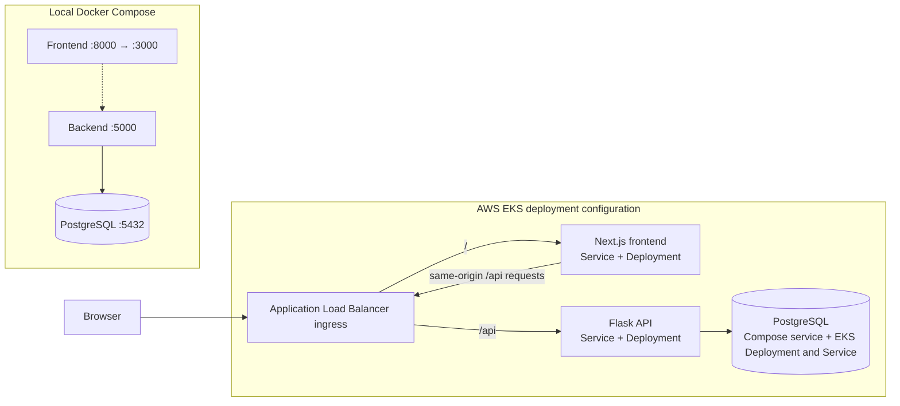

# Smartovate AI Website

Smartovate is a web platform for presenting professional certification courses, instructors, and course details. This repository contains a Next.js frontend, a Flask REST API, PostgreSQL data models, and Docker/Kubernetes deployment configuration. It was developed by a wider team; my individual contribution is summarized below.

> **Project status:** The repository includes PostgreSQL, backend, and frontend Kubernetes manifests and a GitHub Actions workflow that applies them to AWS EKS. This documents the configured deployment path; it does not claim a live production deployment.

## Architecture



The local dashed frontend-to-backend connection illustrates the application flow, not a configured local proxy: frontend API requests use relative `/api/...` paths, while the checked-in local Compose setup does not define a proxy or Next.js rewrite for those paths. In the EKS manifests, the ALB ingress routes `/api` to the backend service and `/` to the frontend service.

## Technology

| Area | Technologies in the repository |
| --- | --- |
| Frontend | Next.js 14, React 18, TypeScript, Tailwind CSS, i18next |
| Backend/API | Python, Flask, Flask-SQLAlchemy, Flask-Migrate, Gunicorn |
| Data | PostgreSQL, SQLAlchemy |
| Integrations | Stripe, AWS SDK for Python (boto3), Flask-Mail/SendGrid |
| Containers & orchestration | Docker, Docker Compose, Kubernetes, Amazon EKS, AWS Load Balancer Controller |
| Delivery & logs | GitHub Actions, Amazon ECR, GitHub Actions OIDC configuration, Fluent Bit/CloudWatch configuration |

## Implemented features

- Course and certification listings, bestseller data, instructor pages, and course detail views.
- Flask API routes for certifications, instructors, feedback, reports, checkout/payment verification, and a `/api/health` endpoint.
- PostgreSQL-backed models for users, certifications, instructors, lessons, quizzes, feedback, and payment logs.
- Stripe checkout and webhook-related service code; email/report functionality; AWS/S3 configuration references.
- English, French, and Arabic frontend locale files.
- Dockerfiles and a Compose file for the frontend, backend, and PostgreSQL.
- Kubernetes frontend/backend deployments and services, an ALB ingress, and Fluent Bit configuration for CloudWatch Logs.

These are repository capabilities, not a claim that every integration is configured or running in a public environment.

## Run locally

### Prerequisites

- Node.js 20 and npm for the frontend.
- Python 3.12 and PostgreSQL for running the backend outside Docker, or Docker with the Compose plugin.
- For payment, email, or S3-backed functionality, provide the corresponding development credentials through your own local environment. Do not commit secrets.

### Frontend

```bash
cd frontend
npm ci
npm run dev
```

The Next.js development server starts at `http://localhost:3000`. A Stripe publishable key is read from `NEXT_PUBLIC_STRIPE_PUBLISHABLE_KEY` when payment UI is used.

### Backend and database with Docker Compose

From the repository root, create an untracked `.env` file containing local values for `POSTGRES_USER`, `POSTGRES_PASSWORD`, `POSTGRES_DB`, and `DATABASE_URL`. Use the Compose service name `db` as the database host, for example `postgresql://<user>:<password>@db:5432/<database>`. The backend configuration also reads `MAIL_PORT`; Compose supplies `587` to the backend.

```bash
docker compose up --build
```

The Compose file maps the frontend to port `8000`, the Flask API to `5000`, and PostgreSQL to `5432`. The backend container entrypoint runs Flask migration commands before launching Gunicorn. The Compose file does not provide real integration credentials. Also, the frontend's relative `/api` requests are not proxied to the backend in this local setup; for an end-to-end local flow, configure a local reverse proxy or frontend rewrite before using those pages.

### Run the API directly (optional)

```bash
cd backend
python -m venv .venv
source .venv/bin/activate        # Windows: .venv\Scripts\activate
pip install -r requirements.txt
export DATABASE_URL='postgresql://<user>:<password>@localhost:5432/<database>'
export MAIL_PORT=587
flask --app 'app:create_app()' run --port 5000
```

Set any additional environment values required for the feature you are exercising. The app factory reads database, mail, Stripe, and AWS settings from its configuration environment. Keep real values in a local, untracked environment file or a secrets manager.

## Docker and Kubernetes deployment

The frontend Dockerfile builds the Next.js application and serves it on port `3000`; the backend Dockerfile installs Python requirements and starts Gunicorn through its entrypoint. `docker-compose.yml` provides a local three-service stack.

The `eks/` directory contains PostgreSQL, frontend, and backend Deployments and Services, an ALB Ingress and IngressClass, plus a Fluent Bit ConfigMap. The Actions workflow is configured to:

1. Build and publish frontend/backend container images to Amazon ECR.
2. Assume an AWS role through GitHub Actions OIDC.
3. Create Kubernetes Secrets from configured GitHub Actions secrets.
4. Apply database, backend, frontend, and ingress resources to EKS and wait for rollouts.
5. Report pod/service state and inspect the ingress after deployment.

**Verification note:** the workflow applies the checked-in database, backend, frontend, and ingress manifests and includes rollout and post-deployment Kubernetes resource checks. It does not run application-level tests, and no application test suite files were found in this checkout. These workflow steps document deployment configuration; they are not evidence of a currently live production deployment.

## Monitoring, logging, and security configuration

- The backend exposes `/api/health`; the backend Service includes an ALB health-check path annotation for it.
- The API logs elapsed time for the certification-list endpoint and returns an `X-Response-Time` header.
- A Fluent Bit ConfigMap describes collecting container logs and sending them to CloudWatch Logs. Its installation/apply steps are commented out in the Actions workflow, so this file alone does not prove centralized logging is active.
- The workflow requests an OIDC token for AWS role assumption and creates Kubernetes Secrets from GitHub Actions secrets. The manifests consume selected settings through Kubernetes `secretKeyRef`.
- The Ingress manifest is configured as internet-facing. TLS/certificate annotations are commented out; HTTPS is not evidenced by the checked-in ingress configuration.

These statements describe checked-in configuration only. They are not a security audit or evidence of a currently healthy, secured production environment. Keep credentials out of source control and use managed secrets for deployments.

## My contribution

The repository history attributes two June 2025 commits to my GitHub account. They cover frontend homepage work, including page data and assets and edits to the hero, courses, mentor, newsletter, header, footer, and layout components. The wider team authored the majority of the repository history; I am not claiming sole authorship of the application, backend, or AWS/EKS deployment.

## License

See [LICENSE](LICENSE).
